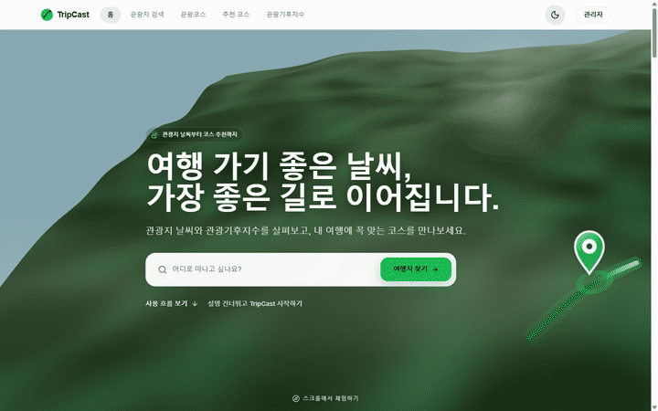
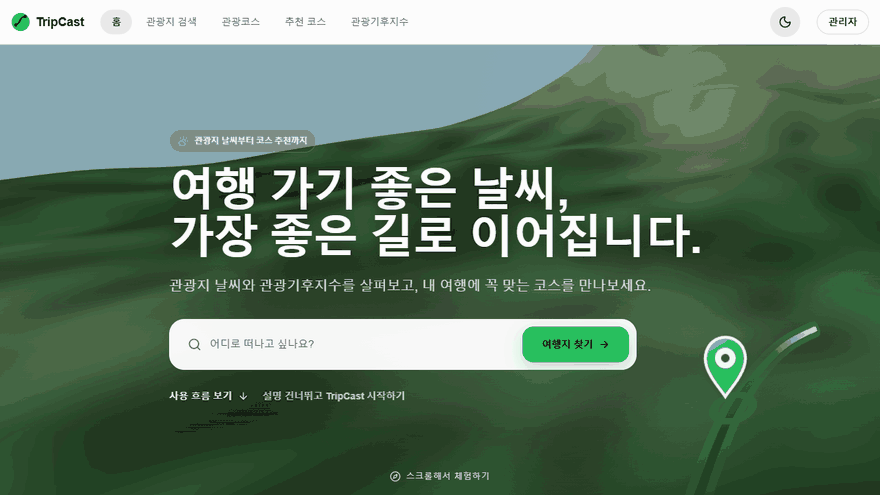
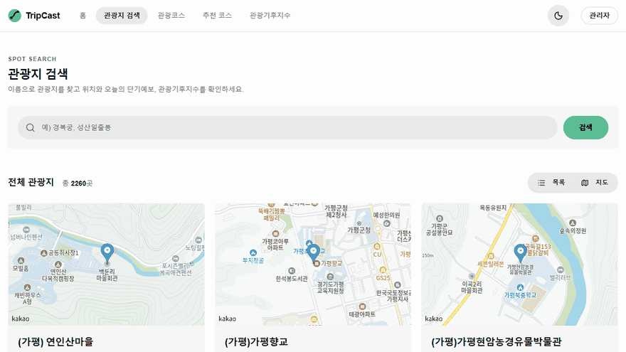
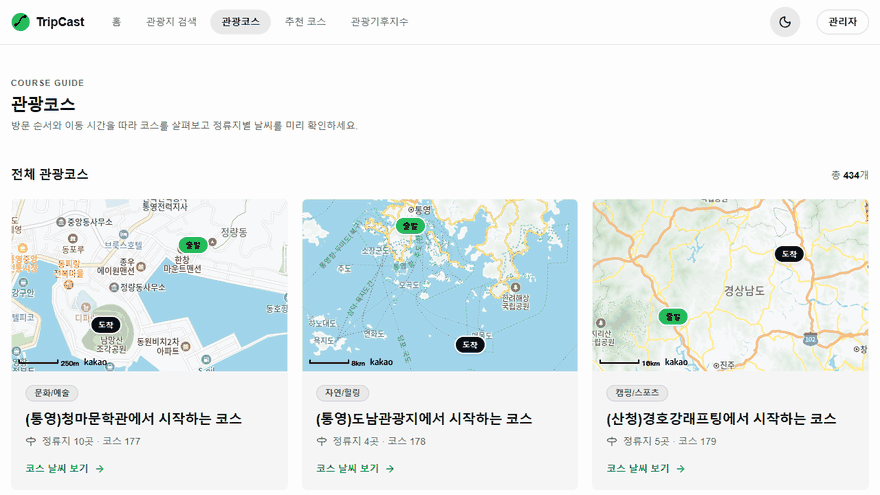
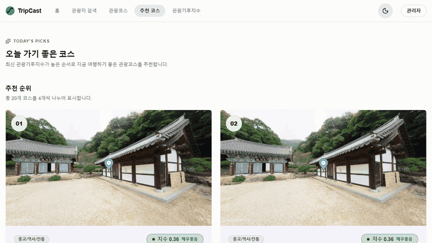
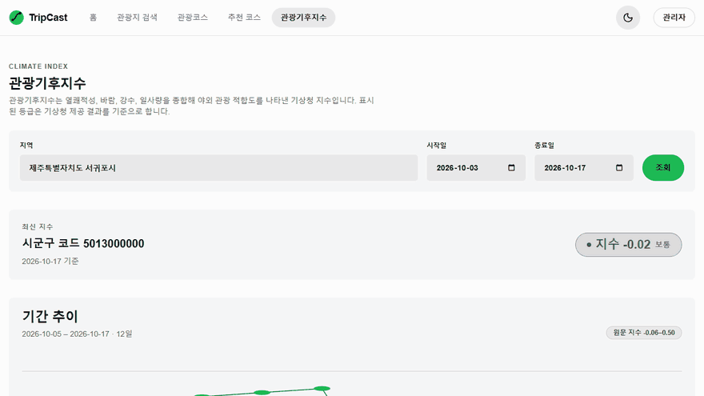

# TripCast Frontend

날씨와 관광기후지수를 바탕으로 여행지와 관광코스를 탐색하고, 오늘 가기 좋은 코스를 추천받을 수 있는 TripCast 웹 서비스의 프론트엔드입니다.

- 서비스: [TripCast 바로가기](https://tripcastwith.duckdns.org)
- 백엔드: [TripCast-was](https://github.com/Trip-Cast/TripCast-was)

## 서비스 미리보기



관광지를 검색하고 장소별 날씨를 확인한 뒤, 관광기후지수를 바탕으로 추천된 여행 코스와 이동 경로를 탐색할 수 있습니다.

### 스크롤텔링 서비스 소개

스크롤에 맞춰 검색 → 날씨 → 코스 → 관광기후지수 순서로 TripCast의 사용 흐름이 이어집니다.



### 관광지 검색과 날씨

이름으로 관광지를 검색하고 목록과 지도 보기를 전환하며, 상세 화면에서 단기예보와 관광기후지수를 확인합니다.



### 관광코스 탐색

코스에 포함된 관광지를 방문 순서대로 지도에 연결하고, 지점별 날씨를 함께 보여 줍니다.



### 오늘의 추천 코스

최신 관광기후지수가 높은 순서대로 오늘 가기 좋은 코스를 추천합니다.



### 관광기후지수 조회

지역과 기간을 선택해 최신 지수와 기간별 변화 추이를 확인합니다.



---

## 목차

- [주요 기능](#주요-기능)
- [기술 스택](#기술-스택)
- [실행 방법](#실행-방법)
- [프로젝트 구조](#프로젝트-구조)
- [테스트](#테스트)
- [문서](#문서)
- [관련 저장소](#관련-저장소)
- [컨벤션](#컨벤션)

---

## 주요 기능

- **관광지 검색**: 이름으로 관광지를 검색하고 상세 정보를 확인합니다.
- **관광지 날씨**: 선택한 관광지의 기상청 단기예보를 제공합니다.
- **관광코스 탐색**: 코스에 포함된 관광지와 이동 경로를 지도에서 확인합니다.
- **코스 추천**: 관광기후지수를 기반으로 오늘 가기 좋은 관광코스를 추천합니다.
- **관광기후지수 조회**: 지역별 최신 지수와 기간별 변화 추이를 제공합니다.
- **관리자 기능**: JWT 인증을 거쳐 관광기후지수 동기화를 직접 실행할 수 있습니다.
- **반응형 UI**: 모바일, 태블릿, 데스크톱 환경에 맞는 화면을 제공합니다.

## 기술 스택

| 분야         | 기술                                                                                                                                                                                                                                                                                                                                              |
| ------------ | ------------------------------------------------------------------------------------------------------------------------------------------------------------------------------------------------------------------------------------------------------------------------------------------------------------------------------------------------- |
| Core         |                                |
| UI           |             |
| 3D           |                                                                                                           |
| 상태 및 API  |                                                   |
| 지도         |                                                                                                                                                                                                                                          |
| 테스트       |    |
| 빌드 및 배포 |                      |

<details>
<summary><h2>실행 방법</h2></summary>

### 요구 환경

- Node.js 24.18 이상, 24.x 범위 (`engines: ^24.18.0`, `.nvmrc` 기준 버전: 24.18.0)
- npm 10 이상

### 설치 및 실행

```bash
npm ci
cp .env.example .env
npm run dev
```

Windows PowerShell에서는 환경 파일을 다음과 같이 복사합니다.

```powershell
Copy-Item .env.example .env
```

`npm ci`는 잠금 파일을 기준으로 의존성을 설치하고 `prepare` 단계에서 Husky를 설정합니다. 설치 후 `git config --get core.hooksPath`의 결과가 `.husky/_`인지 확인합니다. 설정이 빠졌다면 `npm run prepare`를 실행합니다.

### 환경 변수

| 변수                     | 설명                      | 기본값                  |
| ------------------------ | ------------------------- | ----------------------- |
| `VITE_API_BASE_URL`      | TripCast 백엔드 API 주소  | `http://localhost:8080` |
| `VITE_KAKAO_MAP_APP_KEY` | 카카오맵 JavaScript 앱 키 | 없음                    |

`VITE_KAKAO_MAP_APP_KEY`가 비어 있으면 지도 대신 안내용 플레이스홀더를 보여 줍니다. 키는 [카카오 개발자 콘솔](https://developers.kakao.com)에서 발급하고, **플랫폼 > Web**에 로컬 주소(`http://localhost:5173`)와 운영 도메인을 등록해야 합니다. 키는 저장소에 커밋하지 않습니다.

### 주요 명령어

| 명령어                 | 설명                                     |
| ---------------------- | ---------------------------------------- |
| `npm run dev`          | Vite 개발 서버 실행                      |
| `npm run build`        | TypeScript 검사 후 프로덕션 빌드         |
| `npm run preview`      | 프로덕션 빌드 로컬 미리보기              |
| `npm run typecheck`    | TypeScript 타입 검사                     |
| `npm run lint`         | ESLint 검사                              |
| `npm run format`       | Prettier 포맷 적용                       |
| `npm run format:check` | Prettier 포맷 검사                       |
| `npm run test`         | Vitest 단위·컴포넌트 테스트 실행         |
| `npm run test:e2e`     | Playwright E2E 테스트 실행               |
| `npm run generate:api` | 로컬 백엔드 OpenAPI 명세로 API 타입 생성 |

`npm run generate:api`는 로컬 백엔드가 실행 중일 때 사용합니다. 현재 `src/types/api.ts`는 운영 백엔드 OpenAPI 명세와 동기화되어 있습니다.

</details>

## 프로젝트 구조

```text
src/
├── app/                  # 라우터, 전역 Provider, 앱 진입점
├── features/
│   ├── home/             # 홈과 3D 서비스 소개
│   ├── spots/            # 관광지 검색, 상세, 날씨
│   ├── courses/          # 코스 목록, 상세, 추천
│   ├── climate/          # 관광기후지수 조회
│   ├── admin/            # 관리자 인증과 데이터 동기화
│   └── not-found/        # 404 화면
├── shared/               # 공통 API, 컴포넌트, 훅, 유틸리티
├── test/                 # 테스트 공통 설정
└── types/                # OpenAPI 기반 API 타입
```

## 테스트

- **단위 테스트**: 공통 유틸리티와 API 오류 처리 로직을 검증합니다.
- **컴포넌트 테스트**: 주요 페이지, 지도, 카드, 페이지네이션 등의 렌더링과 상호작용을 검증합니다.
- **E2E 테스트**: 홈, 관광지 검색과 상세, 코스 목록과 상세, 추천 코스, 관광기후지수, 관리자 인증 흐름을 검증합니다.
- **반응형 테스트**: 모바일, 태블릿, 데스크톱 화면의 가로 스크롤 발생 여부를 확인합니다.

Playwright E2E 테스트는 `/api/**` 요청을 mock하므로 백엔드 없이 실행할 수 있습니다. 카카오맵 키가 없는 플레이스홀더 상태를 기준으로 하며, 테스트 실행 시 로컬 `.env`의 키는 사용하지 않습니다.

처음 실행할 때는 Chromium을 설치합니다.

```bash
npx playwright install chromium
npm run test:e2e
```

## 문서

- [페이지별 기능 명세](docs/frontend-spec.md): 사이트맵, 기능 요구사항, 3D 히어로 섹션 상세
- [개발환경 구성](docs/development-environment.md): 검증 명령과 의존성 도입 기준
- [배포 가이드](docs/deployment.md): Docker, GHCR, Nginx, EC2 배포

## 관련 저장소

- 프론트엔드: [TripCast-web](https://github.com/Trip-Cast/TripCast-web)
- 백엔드: [TripCast-was](https://github.com/Trip-Cast/TripCast-was)

<details>
<summary><h2>컨벤션</h2></summary>

### 커밋 컨벤션

커밋 메시지는 `type: 한글 설명` 형식을 사용합니다.

| type       | 설명                                  |
| ---------- | ------------------------------------- |
| `feat`     | 새로운 기능 추가                      |
| `fix`      | 버그 수정                             |
| `docs`     | 문서 수정                             |
| `style`    | 코드 포맷팅 등 로직 변경이 없는 수정  |
| `refactor` | 기능 변경이 없는 코드 개선과 리팩터링 |
| `test`     | 테스트 코드 추가·수정                 |
| `chore`    | 빌드 설정, 패키지 관리 등 기타 변경   |
| `merge`    | 브랜치 또는 PR 병합                   |

예시: `feat: 날씨 조회 API 추가`

### 브랜치 컨벤션

작업 브랜치는 `type/작업내용` 형식을 사용하며, 작업 내용은 영문 소문자와 하이픈으로 작성합니다.

| 브랜치       | 설명                            |
| ------------ | ------------------------------- |
| `main`       | 배포 가능한 안정 버전           |
| `feature/*`  | 기능 개발                       |
| `refactor/*` | 코드 리팩터링                   |
| `test/*`     | 테스트 코드 추가·보강           |
| `chore/*`    | 빌드 설정과 의존성 등 기타 변경 |
| `ci/*`       | CI/CD 설정 변경                 |

예시: `feature/admin-auth`, `chore/add-dockerfile`, `refactor/remove-spot-weather-index`

</details>
